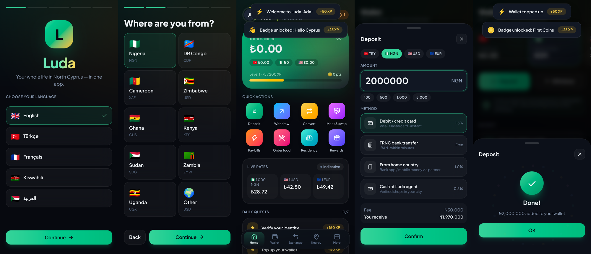
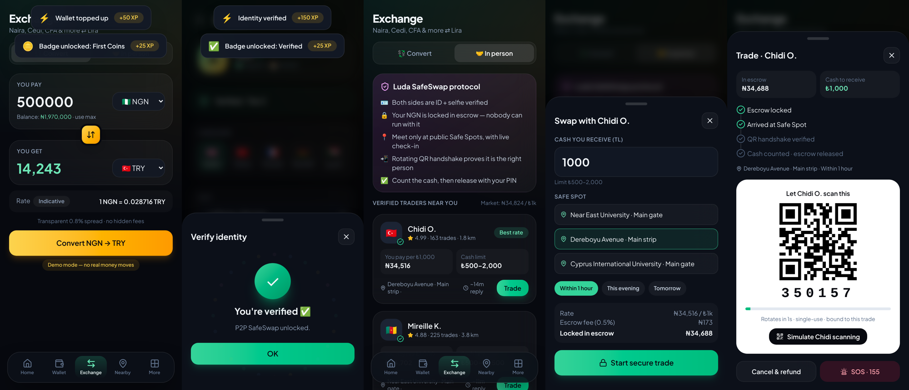
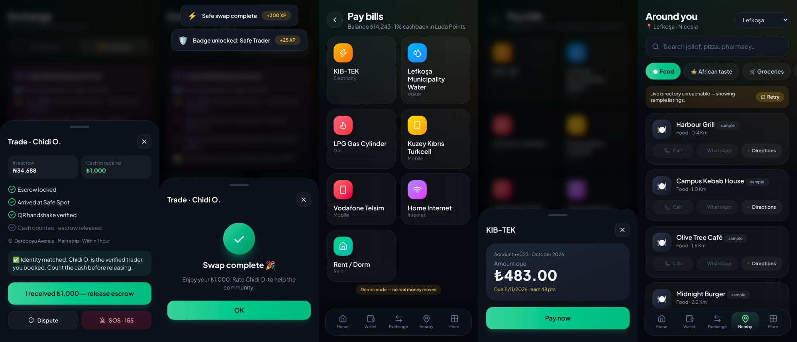
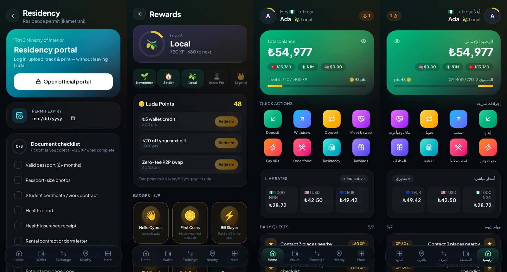

# Luda — North Cyprus, levelled up

An all-in-one, gamified app for the African community in North Cyprus (TRNC). It covers the wallet, currency exchange, safe in-person swaps, bills, residency paperwork and city life, in five languages.






## Run it

```bash
cd app
npm install
npm run dev        # http://localhost:5173
npm run build      # production build in app/dist
```

It is a mobile-first PWA: open it on a phone and "Add to Home Screen". On a desktop it renders as a phone frame.

## What's inside

| Area | What it does | Status |
|---|---|---|
| **Onboarding** | Language → home country → city → name → 4-digit PIN (salted SHA-256, never stored in plain text) | ✅ |
| **Wallet** | Multi-currency balances (TRY, NGN, USD, EUR, home currency). Deposits by card, TRNC bank, home-country rails or cash agent. Withdrawals are PIN-protected. Fees shown before you confirm. | ✅ demo ledger |
| **Convert** | Live FX from open.er-api.com, with indicative fallback rates. Naira, Cedi, CFA, Congolese franc, Shilling and more ⇄ Lira. 0.8% spread shown up front. | ✅ live rates |
| **SafeSwap (P2P in person)** | KYC-gated. Your money is locked in escrow, you meet at public Safe Spots (university gates, busy streets), a **rotating TOTP-style QR/6-digit handshake** (HMAC-SHA256, 30 s window) proves you have the right person, then you count the cash and release with your PIN. Cancel/refund, dispute (freezes escrow) and SOS 155 buttons. | ✅ protocol simulated |
| **Bills** | KIB-TEK electricity, municipality water (per city), LPG cylinder, Turkcell / Telsim top-up, home internet, rent. Saved accounts and 1% cashback in Luda Points. | ✅ mock biller |
| **Around me** | Live city directory from **OpenStreetMap (Overpass API)**: food, *African taste*, groceries, pharmacies, clinics, banks/ATMs/exchange, hair & beauty, worship. One-tap Call / WhatsApp / Directions. | ✅ live data |
| **Residency** | Opens the official portal in an in-app secure browser (Luda never sees the password), with a document checklist, permit-expiry countdown and step-by-step guide | ✅ |
| **Housing & Roommates** | Listings per city, filters, verified landlords, reviews, viewings, roommate matching, report taken/fake | ✅ sample data |
| **Jobs** | Verified employers, permit-support flag, apply & track, post a job | ✅ sample data |
| **Community** | Church & mosque services, culture, sports, career and help events; RSVP; add to calendar | ✅ sample data |
| **University hub** | Pick your school → only its deadlines & fees; pay tuition from wallet; **timetable screenshot reader that runs on the phone** (tesseract.js, image never uploaded) with review/edit; reminders only if the user turns them on; calendar export | ✅ OCR real, dates sample |
| **Transport** | Taxi fare estimate and share-my-trip safety (tickets above) | ✅ estimates |
| **Posting safety** | Every poster: phone OTP + legal declaration (ID optional = ✓ badge). Houses: a resident's KIB-TEK/water bill, deed or agent licence → live instantly; photos only → admin approval. Jobs: business registration or "Individual". All posts reviewed before going live, hidden after 7 days unless confirmed available, user reports, 1 active post for new posters | ✅ flow simulated |
| **Admin console** | Owner reviews queue with red-flag checks, approves/rejects with reasons, posts as "Luda Official" | ✅ |
| **Personalisation** | Night / Day / Auto theme; choose and order home shortcuts (max 8) and home sections | ✅ |
| **Group chats** | Discover / join / create groups, chat bubbles, replies, reactions, typing indicator, unread badges. Safety: on-device bad-word filter (EN, TR, FR, SW, AR + Pidgin, catches disguised spellings), scam-message blocker, 3 strikes = 10-min mute, flood control, report/block, group rules on join | ✅ demo members |
| **Quick job post** | Type one line ("1 worker needed in Girne for construction"), app detects workers/area/type/pay, goes live instantly after phone check + filter | ✅ |
| **Bus & shuttle tickets** | Girne ⇄ Lefkoşa (VirgoBus + second operator), other routes, KIBHAS airport shuttle. Luda price = official − ₺12 (single) / − ₺14 (return) per passenger; pay with wallet (PIN) or card; QR e-ticket; refund. Operators & fares in `config.ts` | ✅ payment simulated |
| **Flash help** | Post a quick need ("washing machine broken") → animated bubbles on Home + pop-up alerts for people nearby → fixers send offers → pay via **escrow** (released only when you confirm the job is done) or cash with a clear "not protected" warning → rating. Anyone can also be the fixer and get paid through escrow | ✅ demo offers |
| **Gamification** | XP, 5 levels (Newcomer → Legend), daily streaks, 7 quests, 9 badges, redeemable Luda Points and a community leaderboard by country, plus XP toasts and confetti | ✅ |
| **Languages** | English, Türkçe, Français (DRC/Cameroon), Kiswahili (Kenya/Uganda/E. DRC), العربية (Sudan) with full RTL | ✅ |

Everything is saved on the device (`localStorage`) so the demo is fully interactive with no backend. **No real money moves**, and every money screen says so.

## Code map

```
app/src
├── config.ts            portal URL, FX/Overpass endpoints, fees
├── lib/
│   ├── data.ts          countries, currencies, cities, Safe Spots, billers, levels, badges, quests
│   ├── i18n.ts          5 language packs
│   ├── store.tsx        app state, XP/badges/quests engine, toasts, PIN check
│   ├── crypto.ts        PIN hashing + rotating handshake codes (Web Crypto)
│   ├── fx.ts            live rates + formatting
│   └── places.ts        OpenStreetMap city directory
├── components/          Sheet, PinPad, Ring, Toasts, confetti, TxList…
└── screens/             Onboarding, Home, Wallet, Exchange, Bills, Nearby, Residency, Rewards, Profile, More
```

## Path to production

1. **Money (licensing first).** Holding customer funds needs a licensed partner: an e-money/payment institution or a TRNC bank, plus a Nigerian/Ghanaian payout partner for home-country rails. Replace the local ledger in `store.tsx` with a backend double-entry ledger (e.g. Postgres) behind an API.
2. **KYC.** Plug a provider (Smile ID is strong for African IDs; Onfido or Sumsub also work) into `Profile.tsx`.
3. **Escrow and SafeSwap.** Move escrow and handshake secrets to the server. The counterparty app scans the QR and the server verifies the code, then add ratings and dispute ops.
4. **Bills.** Integrate with KIB-TEK, the municipalities and the telcos through an aggregator or direct agreements. The current amounts are deterministic mocks.
5. **Residency portal.** `RESIDENCY_PORTAL_URL` is set to `https://permissions.gov.ct.tr/login` (TRNC permits portal); re-check before launch. Government sites often block embedding inside other web pages. In a native build (Capacitor), the in-app browser plugin opens it inside the app. The user always logs in with the government directly; credentials are never scraped or stored.
6. **Native apps.** Wrap with Capacitor for Play Store and App Store builds and push notifications (bill due, permit expiry, trade updates).
